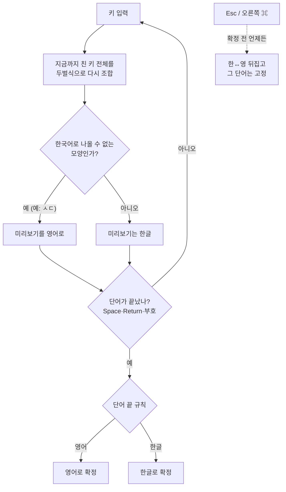

# 눈치 (Nunchi)

눈치껏 한글과 영어를 골라 주는 입력기. 치는 도중 영어를 알아채 바로 바꿔 주는 macOS 두벌식 한영 자동전환 입력기.

- 한글로는 나올 수 없는 모양(홀로 남은 자모 등)이 보이면 단어 중간에 영어로 바꾼다. 예: `te` → `ㅅㄷ` 대신 `te`.
- 애매한 짧은 단어(`git`, `the`)는 단어 끝(Space·Return·문장부호)에서 작은 사전과 앞 단어로 정한다.
- 판별이 틀리면 확정 전에 `Esc`(터미널·IDE 제외) 또는 오른쪽 `⌘` 단독 탭으로 한↔영을 뒤집는다.
- 비밀번호 칸(보안 입력)에서는 조합하지 않고 키를 그대로 넘긴다.
- 네트워크 통신·자동 업데이트·손쉬운 사용 권한·전역 키 감시를 쓰지 않는다.

## 작동 방식

**단어를 잔뜩 저장해 두고 맞춰 보는 방식이 아니다.** 저장된 영어 단어는 51개뿐이고, 판별의 대부분은
"이 키들을 두벌식으로 조합하면 한국어가 될 수 있나?"라는 **규칙 하나**로 한다. AI·통계 모델·네트워크는 쓰지 않는다.

### 한 줄 요약

> 키를 누를 때마다 한글로 조합해 본다 → 한국어로는 **절대 나올 수 없는 모양**이 생기면 그 순간 영어로 바꾼다
> → 끝까지 애매하면 단어가 끝날 때(Space·Return·문장부호) 몇 가지 규칙으로 정한다.

### 흐름



### 1단계: 치는 도중 — "한국어로 불가능한 모양" 찾기

두벌식은 자음·모음이 정해진 순서로 붙어야 글자가 된다. 그래서 **모음 없이 자음이 이어지거나**(`ㅅㄷ`),
**자음 없이 모음이 홀로 남으면**(`ㅏㅏ`) 한국어 단어일 수 없다. 이런 "홀로 남은 자모"가 두 번째 키부터
보이면 그 단어는 영어로 본다.

| 친 키 | 한글로 조합하면 | 판단 |
|---|---|---|
| `t` | ㅅ | 한 글자라 아직 모름 → 한글 유지 |
| `te` | ㅅㄷ | ㅅ 뒤에 모음 없이 ㄷ → 불가능 → **바로 `te`** |
| `dkssud` | 안녕 | 끝까지 정상 조합 → 한글 |

예외로 두는 것:
- 채팅 줄임말(`ㅋㅋ`·`ㅠㅠ`·`ㅇㅋ`·`ㄱㅅ` 등)과 단어 끝에 붙는 웃음(`좋아ㅋㅋ`)은 낱자여도 한글로 둔다.
- 대문자로 시작하면 바로 영어(`Hello`). 단, Shift 를 눌러 쌍자음·ㅒ·ㅖ 를 치는 `Q W E R T O P` 는 뺀다.
- **끝에 남은 낱자음은 기다린다.** `애찯` 다음 `ㄱ` 처럼 자음이 남아도, 다음에 모음이 오면 글자가 될 수 있어서 도중에는 판단하지 않는다.

### 2단계: 단어 끝 — 남은 애매한 단어 정하기

단어가 끝났을 때 위에서부터 차례로 본다.

1. 도중에 이미 영어가 됐으면 → **영어**
2. 끝에 낱자음이 남았으면(`docker` → `애찯ㄱ`) → **영어**. 한국어 단어는 이렇게 끝나지 않는다.
3. 작은 단어 목록(`Lexicon.swift`, 51개)에 있으면 → **영어**. 한글로도 멀쩡히 조합되는 영어만 담았다(`git` → 햣, `the` → 솓, `rm` → 그).
   - 그중 한국어로도 흔한 단어(`to` = 새, `rm` = 그 등 12개)는 **앞 단어의 언어를 따른다**. `want to` → to, `세상 새` → 새.
4. 나머지 → **한글**

터미널·IDE 에서는 "앞 단어가 영어였다"고 보고 시작해서, `rm` 처럼 겹치는 단어가 영어로 나온다.

### 미리보기와 뒤집기

- 치는 동안에는 밑줄 친 **미리보기**(아직 확정 안 된 글자)로 보여 주고, 단어가 끝나야 앱에 확정해 넣는다.
- 판별이 틀렸으면 확정 전에 `Esc`(터미널·IDE 에서는 Esc 를 앱에 넘기므로 오른쪽 `⌘` 한 번)로 뒤집는다. 뒤집은 단어는 끝날 때까지 그대로 둔다.
- 비밀번호 칸에서는 조합도 미리보기도 하지 않고 키를 그대로 넘긴다.

### 규칙을 어떻게 정했나

설계할 때 자주 쓰는 영어 약 1만 단어와 한국어 약 5만 단어를 이 규칙으로 쳐 보며 확인했다(그 목록은 확인용이라 입력기에는 들어 있지 않다).
영어는 92.4% 가 단어 도중에 영어로 바뀌었고, 한국어 단어를 영어로 잘못 바꾼 경우는 없었다. 규칙으로 못 잡는 영어
(`git` 처럼 한글로도 조합되는 단어)는 단어 목록으로 막고, 앞으로 사용자 단어장으로 채울 예정이다.

### 코드에서 어디에 있나

| 단계 | 파일 |
|---|---|
| 두벌식 조합(키 → 한글, 홀로 남은 자모 표시) | `Sources/NunchiCore/HangulComposer.swift`, `Jamo.swift` |
| 1단계: 치는 도중 판단, 줄임말 예외 | `Sources/NunchiCore/EnglishSignal.swift` |
| 2단계: 단어 끝 규칙, 단어 목록 | `Sources/NunchiCore/WordJudge.swift`, `Lexicon.swift` |
| 미리보기·뒤집기·앞 단어 기억 | `Sources/NunchiCore/InputSession.swift` |
| 키마다 할 일 결정(미리보기 / 확정 / 앱에 넘기기) | `Sources/NunchiCore/KeyRouter.swift` |

## 빌드·설치

Command Line Tools(또는 Xcode)만 있으면 된다.

```bash
./scripts/test.sh        # 단위 테스트
./scripts/install.sh     # 빌드 → ~/Library/Input Methods 설치 → 입력 소스 등록
```

설치 후 **로그아웃했다가 다시 로그인**한 뒤 시스템 설정 > 키보드 > 입력 소스에서 "눈치"를 고른다.
예전 이름("한영 자동")으로 설치돼 있었다면 `install.sh` 가 입력 소스에서 빼고 지운다.
이미 설치된 버전을 덮어쓴 경우에도 로그아웃이 필요하다(아래 알려진 문제).

## 구조

| 위치 | 하는 일 |
|---|---|
| `Sources/NunchiCore/HangulComposer.swift` | 두벌식 조합기 |
| `Sources/NunchiCore/EnglishSignal.swift` | 치는 도중 영어 신호 |
| `Sources/NunchiCore/WordJudge.swift`, `Lexicon.swift` | 단어 끝 판별 |
| `Sources/NunchiCore/InputSession.swift` | 치고 있는 단어 상태 |
| `Sources/NunchiCore/KeyRouter.swift` | 키 → 미리보기/확정/통과 결정 |
| `Sources/Nunchi/InputController.swift` | InputMethodKit 연결(판단 로직 없음) |
| `scripts/make-icon.swift` | 메뉴 막대 아이콘·앱 아이콘 생성(그림은 `docs/logo.svg` 와 같음) |
| `scripts/e2e.swift` | 실제 입력기로 타이핑해 보는 개발용 도구(포커스를 가져간다) |

## 알려진 문제

- 설치된 입력기를 덮어쓰고 프로세스를 다시 띄우면, 앱들이 옛 연결을 붙잡아 키가 사라진다. 로그아웃·로그인으로 풀린다.
- 입력기를 새로 추가하거나 빼면 입력 메뉴 목록이 로그아웃·로그인 전까지 바뀌지 않을 수 있다(TextInputMenuAgent 재시작으로는 안 풀렸다).
- E2E(가짜 키 입력)에서 비밀번호 칸 입력 일부가 사라졌지만 실제 키보드로는 문제가 없었다. Return 이 줄바꿈 없이 확정만 되는 현상, 오른쪽 ⌘ 탭(가짜 이벤트)이 안 먹는 현상을 조사 중.
- Command Line Tools 6.4 에서 Swift Testing 매크로 플러그인을 간헐적으로 못 찾는 문제가 있어 `scripts/test.sh` 가 그 오류일 때만 다시 시도한다.

## 참고

hannyeong 등 다른 입력기의 코드는 보지 않고 새로 작성했다(동작 관찰만 참고). 라이선스는 공개 전환 시 정한다.
