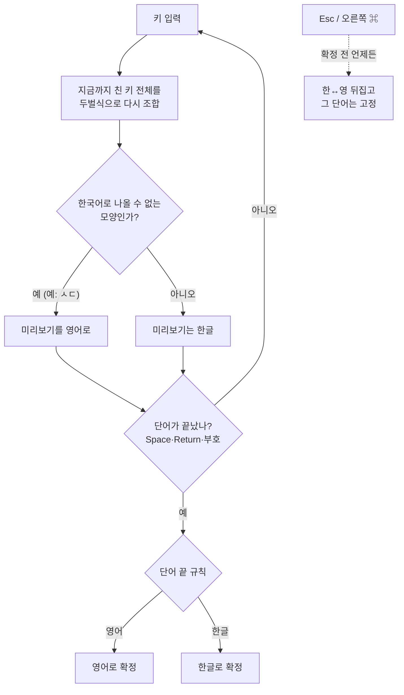

# 눈치 (Nunchi)

눈치껏 한글과 영어를 골라 주는 입력기. 치는 도중 영어를 알아채 바로 바꿔 주는 macOS 두벌식 한영 자동전환 입력기.

- 한글로는 나올 수 없는 모양(홀로 남은 자모 등)이 보이면 단어 중간에 영어로 바꾼다. 예: `te` → `ㅅㄷ` 대신 `te`.
- 애매한 짧은 단어(`git`, `the`)는 단어 끝(Space·Return·문장부호)에서 작은 사전과 앞 단어로 정한다.
- 판별이 틀리면 확정 전에 `Esc`(터미널·IDE 제외) 또는 오른쪽 `⌘` 단독 탭으로 한↔영을 뒤집는다.
- 비밀번호 칸(보안 입력)에서는 조합하지 않고 키를 그대로 넘긴다.
- 네트워크 통신·자동 업데이트·손쉬운 사용 권한·전역 키 감시를 쓰지 않는다.

## 시작하기

### 1. 설치

[Homebrew](https://brew.sh) 가 있으면 한 줄이면 된다.

```bash
brew install --cask apsoei/tap/nunchi
```

설치가 끝나면 입력 소스 등록과 켜기까지 자동으로 된다. **키보드 설정에서 직접 추가할 필요는 보통 없다.**

### 2. 입력 소스로 고르기

메뉴 막대의 입력 메뉴(지금 쓰는 입력 소스 아이콘)를 눌러 **눈치**를 고른다. 아이콘은 `ㄴn` 모양이다.

처음 설치한 맥에서는 macOS 가 입력 메뉴 목록을 바로 갱신하지 않아 눈치가 안 보일 수 있다.

1. 안 보이면 **로그아웃했다가 다시 로그인**한다. 이미 켜져 있어서 대부분 이걸로 나타난다.
2. 그래도 없으면 **시스템 설정 › 키보드 › 텍스트 입력 › 입력 소스** 옆의 **편집…** → 왼쪽 아래 **+** → **한국어** → **눈치** → **추가**.

메뉴 막대에 입력 메뉴가 안 보이면 같은 화면에서 **메뉴 막대에서 입력 메뉴 보기**를 켠다.
눈치 하나로 한글·영어를 다 치므로, 다른 한글 입력기(2벌식 등)와 ABC 는 목록에서 빼도 된다. 바꿔 가며 쓰려면 `⌃Space` 로 전환한다.

### 3. 쓰기

- **그냥 치면 된다.** 한글은 한글로 나오고, 영어는 치는 도중 영어로 바뀐다(`te` 를 치는 순간 `ㅅㄷ` → `te`). 밑줄은 아직 확정 전이라는 표시다.
- **틀렸으면** 단어를 끝내기 전(Space·Return 전)에 `Esc` 를 누르면 한↔영이 뒤집힌다. 터미널·IDE 에서는 Esc 를 앱에 넘기므로 **오른쪽 `⌘` 를 한 번** 누른다.
- **이미 Space 를 눌렀으면** 바로 **오른쪽 `⌘`** 를 누른다. 방금 단어를 지우고 반대 언어로 다시 쓴다(한 번 더 누르면 원래대로). 다른 키를 치면 취소되고, Return·문장부호로 끝낸 단어와 터미널에서는 안 된다.
- **자주 틀리는 단어**는 입력 메뉴 › **단어장 열기** 에서 원하는 모양 그대로 한 줄 적는다([단어장](#단어장)). 같은 단어를 Esc·오른쪽 ⌘ 로 두 번 뒤집으면 알아서 배운다.
- 비밀번호 칸에서는 조합을 멈추고 키를 그대로 넘긴다.

### 업데이트·삭제

```bash
brew upgrade --cask apsoei/tap/nunchi # 업데이트 — 먼저 입력 소스를 ABC 등으로 바꾸고, 끝나면 '눈치'를 다시 고른다
brew uninstall --cask apsoei/tap/nunchi # 삭제 (단어장은 남김)
brew uninstall --cask --zap nunchi    # 단어장까지 삭제
```

### 알아 둘 것

- Apple 개발자 서명이 없는 앱이라, 설치할 때 macOS 의 "인터넷에서 받은 파일" 표시(quarantine)를 지운다. 회사 맥이면 보안 담당 확인을 먼저 받는다.
- 키가 안 먹으면 다른 입력 소스로 바꿨다가 다시 눈치를 고른다. 그래도 안 되면 로그아웃·로그인.
- 네트워크를 쓰지 않아 친 내용을 어디로도 보내지 않는다. 파일에 남는 것은 단어장(`~/Library/Application Support/Nunchi/words.txt`, 직접 적은 단어와 Esc 로 배운 단어)뿐이다.

## 작동 방식

**단어를 잔뜩 저장해 두고 맞춰 보는 방식이 아니다.** 저장된 영어 단어는 51개뿐이고, 판별의 대부분은
"이 키들을 두벌식으로 조합하면 한국어가 될 수 있나?"라는 **규칙 하나**로 한다. AI·통계 모델·네트워크는 쓰지 않는다.

### 한 줄 요약

> 키를 누를 때마다 한글로 조합해 본다 → 한국어로는 **절대 나올 수 없는 모양**이 생기면 그 순간 영어로 바꾼다
> → 끝까지 애매하면 단어가 끝날 때(Space·Return·문장부호) 몇 가지 규칙으로 정한다.

### 흐름



### 1단계: 치는 도중 — "한국어로 불가능한 모양" 찾기

키를 하나씩 **초성·중성·받침 세 칸짜리 상자**에 채워 본다(`HangulComposer.swift`). 키를 누를 때마다 그 단어의 키 전체를 처음부터 다시 채운다.

- **자음**: 빈 상자면 초성, 초성·중성이 찬 상자면 받침(겹받침 포함).
- **모음**: 중성 칸. 앞 상자에 받침이 있으면 그 받침을 새 상자의 초성으로 옮긴다(겹받침은 뒤쪽만). `dkd` → 앙, `dkdk` → 아아.
- 어느 칸에도 못 들어가면 지금 상자를 닫고 새 상자를 연다.

한국어 글자는 모두 초성과 중성이 있다(소리 없는 초성도 `ㅇ` 으로 채운다). **받침은 비어도 된다.** 그래서 바르게 친 한국어에서는
**초성이나 중성이 빈 채로 닫히는 상자**가 생기지 않는다. 그런 상자("홀로 남은 자모")가 두 번째 키부터 보이면 영어로 본다.

| 친 키 | 상자 | 판단 |
|---|---|---|
| `t` | [ㅅ,_] 채우는 중 | 첫 키라 판단 안 함 → `ㅅ` |
| `te` | [ㅅ,**빈칸**] 닫힘, [ㄷ] | 중성 빈 상자 → **영어 `te`** |
| `dk` | [ㅇ,ㅏ] | 받침은 비어도 정상 → `아` |
| `dkdk` | [ㅇ,ㅏ] [ㅇ,ㅏ] | 셋째 키에서 잠깐 `앙`, 넷째 모음이 받침 ㅇ 을 가져가 → `아아` |
| `dkk` | [ㅇ,ㅏ] [**빈칸**,ㅏ] | 빌려 갈 받침이 없어 모음이 홀로 남음 → **영어 `dkk`** |
| `dkssud` | [ㅇ,ㅏ,ㄴ] [ㄴ,ㅕ,ㅇ] | 정상 → `안녕` |
| `git` | [ㅎ,ㅑ,ㅅ] | 정상 조합이라 이 규칙으로는 못 잡음 → 2단계 단어 목록에서 잡는다 |

**예외: 줄임말·웃음은 한글로 둔다** (`EnglishSignal.isShorthand`). 아래 중 하나면 홀로 남은 자모가 있어도 한글이다.

1. 같은 자모 하나만 반복: `ㄷㄷ`, `ㅅㅅ`, `ㅋㅋㅋㅋ`, `ㅎㅎ` (길이 상관없음)
2. 직접 고른 줄임말 29개: `ㅇㅋ ㄱㅅ ㅈㅅ ㄴㄴ ㄱㄱ ㅎㅇ ㅂㅇ ㄹㅇ ㅊㅋ ㅅㄱ ㄷㄷ ㅂㅂ ㅁㄹ ㅇㄴ ㅈㅂ ㄱㅊ ㄴㅇ ㅇㅈ ㅅㅂ ㅁㅊ ㅇㄷ ㄱㄷ ㅎㄹ ㅇㄱㄹㅇ ㅈㄱㄴ ㅎㅇㅌ ㄴㅇㅅ ㄱㅇㄷ ㅂㅂㅂㄱ`. 같은 키로 치는 영어 단어가 없는 것만 넣는다(`ㅁㅊㄷ` 는 `ace` 라 뺐다). 뒤에 웃음이 붙어도 된다(`ㄹㅇㅋㅋ`)
3. ㅋ·ㅎ·ㅠ·ㅜ·ㅇ 로만 이뤄짐: `ㅋㅋㅎㅎ`, `ㅇㅋㅋ`, `ㅠㅜ`

단어 끝에 붙은 웃음·울음·덜덜(`좋아ㅋㅋ`, `헐ㅠㅠ`, `결함ㄷㄷ`)은 떼고 앞부분만 본다. `ㄷㄷ` 는 두 번 이상일 때만 뗀다(한 번이면 `code` 의 `e` 일 수 있다). `ㄴㄴ` 처럼 다른 자음 반복은 떼지 않는다(`class` → 침ㄴㄴ 이 되므로). 위에 해당하지 않는 줄임말(`ㄱㅅㄱㅅ`)은 영어로 바뀌니 각자 단어장에 적는다.

줄임말을 치는 도중(`ㅇㄱㄹ`)에 영어로 바뀌었다가도, 줄임말이 완성되는 순간(`ㅇㄱㄹㅇ`) 한글로 돌아온다.

그 밖의 규칙:
- 대문자로 시작하면 바로 영어(`Hello`). 단, Shift 로 쌍자음·ㅒ·ㅖ 를 치는 `Q W E R T O P` 는 뺀다.
- **Caps Lock** 이 켜져 있어도 똑같이 판별하고, 영어로 정해지면 대문자로 낸다(`ahslxjfld` → 모니터링, `api` → API). 쌍자음은 Caps Lock 이 아니라 Shift 로만 나온다.
- **끝에 열려 있는 자음 상자는 기다린다.** `docker` 를 치는 도중 `애찯ㄱ` 의 [ㄱ] 은 다음에 모음이 오면 글자가 될 수 있어서 판단하지 않는다(단어 끝에서 2단계가 본다).

### 2단계: 단어 끝 — 남은 애매한 단어 정하기

단어가 끝났을 때 위에서부터 차례로 본다.

0. 사용자 단어장에 있으면 → 그 모양(아래 [단어장](#단어장))
1. 도중에 이미 영어가 됐으면 → **영어**
2. 끝에 낱자음이 남았으면(`docker` → `애찯ㄱ`) → **영어**. 한국어 단어는 이렇게 끝나지 않는다.
3. 작은 단어 목록(`Lexicon.swift`, 51개)에 있으면 → **영어**. 한글로도 멀쩡히 조합되는 영어만 담았다(`git` → 햣, `the` → 솓, `rm` → 그).
   - 그중 한국어로도 흔한 단어(`to` = 새, `rm` = 그 등 12개)는 **앞 단어의 언어를 따른다**. `want to` → to, `세상 새` → 새.
4. 나머지 → **한글**

터미널·IDE 에서는 "앞 단어가 영어였다"고 보고 시작해서, `rm` 처럼 겹치는 단어가 영어로 나온다.

### 미리보기와 뒤집기

- 치는 동안에는 밑줄 친 **미리보기**(아직 확정 안 된 글자)로 보여 주고, 단어가 끝나야 앱에 확정해 넣는다.
- 판별이 틀렸으면 확정 전에 `Esc`(터미널·IDE 에서는 Esc 를 앱에 넘기므로 오른쪽 `⌘` 한 번)로 뒤집는다. 뒤집은 단어는 끝날 때까지 그대로 둔다.
- 비밀번호 칸에서는 조합도 미리보기도 하지 않고 키를 그대로 넘긴다.
- **확정 후 되돌리기:** Space 로 끝낸 직후 오른쪽 `⌘` 를 누르면 입력창에 커서 앞 글자를 물어 보고, 정말 "방금 단어 + 공백"이면 반대 언어로 바꿔 쓴다. 앱이 앞 글자를 알려 주지 않거나(터미널 등) 다르면 아무것도 하지 않는다. 되돌린 것도 배우기에 반영된다.

### 규칙을 어떻게 정했나

설계할 때 자주 쓰는 영어 약 1만 단어와 한국어 약 5만 단어를 이 규칙으로 쳐 보며 확인했다(그 목록은 확인용이라 입력기에는 들어 있지 않다).
영어는 92.4% 가 단어 도중에 영어로 바뀌었고, 한국어 단어를 영어로 잘못 바꾼 경우는 없었다. 규칙으로 못 잡는 영어
(`git` 처럼 한글로도 조합되는 단어)는 단어 목록으로 막고, 그래도 빠진 단어는 사용자가 단어장에 적는다.

### 코드에서 어디에 있나

| 단계 | 파일 |
|---|---|
| 두벌식 조합(키 → 한글, 홀로 남은 자모 표시) | `Sources/NunchiCore/HangulComposer.swift`, `Jamo.swift` |
| 1단계: 치는 도중 판단, 줄임말 예외 | `Sources/NunchiCore/EnglishSignal.swift` |
| 2단계: 단어 끝 규칙, 단어 목록 | `Sources/NunchiCore/WordJudge.swift`, `Lexicon.swift` |
| 미리보기·뒤집기·앞 단어 기억 | `Sources/NunchiCore/InputSession.swift` |
| 키마다 할 일 결정(미리보기 / 확정 / 앱에 넘기기) | `Sources/NunchiCore/KeyRouter.swift` |
| 단어장 읽기·대조, 배우기, 파일 저장 | `Sources/NunchiCore/Wordbook.swift`, `FlipLearner.swift`, `WordbookStore.swift` |

## 단어장

자동 판별이 자꾸 틀리는 단어는 단어장에 적어 두면 항상 그 모양으로 나온다.

- 위치: `~/Library/Application Support/Nunchi/words.txt` (입력 메뉴 › **단어장 열기** 로 연다. 없으면 만들어서 연다)
- 한 줄에 하나씩, **나오길 원하는 모양 그대로** 적는다. 영어로 적으면 영어로, 한글로 적으면 한글로 나온다.
  ```
  git          # g-i-t 를 치면 항상 git
  kubectl
  새           # t-o 를 치면 앞 단어와 상관없이 항상 '새'
  ㄱㅅㄱㅅ       # 줄임말도 한글로 적으면 한글로
  ```
- 단어장 단어는 자동 판별보다 먼저다. 친 키가 단어장 단어와 똑같아지는 순간 미리보기가 그 모양으로 바뀐다. 그래도 Esc 로 뒤집을 수 있다.
- 가끔은 한글, 가끔은 영어로 쓰는 단어는 적지 않는다(앞 단어를 보는 자동 판별에 맡긴다).
- `#` 뒤는 메모. 저장하면 다음에 칠 때부터 반영된다.
- 대소문자는 구분하지 않는다. 단 Shift 로 쌍자음·ㅒ·ㅖ 가 되는 `Q W E R T O P` 는 구분한다(`PR` 과 `pr` 은 다른 단어).

### 뒤집어서 배우기

같은 단어를 Esc·오른쪽 ⌘ 로 **같은 쪽으로 두 번** 뒤집어 확정하면 단어장 아래 칸("Esc로 배운 단어")에 자동으로 들어간다.
배운 단어를 반대로 뒤집으면 반반인 단어로 보고 다시 뺀다. 직접 적은 단어는 건드리지 않는다. 횟수는 입력기가 켜져 있는 동안만 센다.

입력 메뉴:

| 항목 | 하는 일 |
|---|---|
| 단어장 열기 | 단어장 파일을 편집기로 연다 |
| 뒤집어서 배우기 | 켜기·끄기(기본 켬) |
| 배운 단어 지우기 | 배운 단어만 지운다. 직접 적은 단어는 남고, 지우기 전 내용은 `words.txt.bak` 에 남는다 |

## 배포 (관리자용)

tap 저장소: [apsoei/homebrew-tap](https://github.com/apsoei/homebrew-tap) 의 `Casks/nunchi.rb`. 설치 후 quarantine 제거·입력 소스 등록, 삭제 전 해제·종료를 한다.

### 새 버전 배포

1. `./scripts/release.sh 0.3.1` → `dist/Nunchi-0.3.1.zip` 과 sha256 출력
2. `gh release create v0.3.1 dist/Nunchi-0.3.1.zip --title v0.3.1`
3. tap 의 `Casks/nunchi.rb` 에서 `version`, `sha256` 을 바꿔 푸시

## 빌드·설치 (소스에서)

Command Line Tools(또는 Xcode)만 있으면 된다.

```bash
./scripts/test.sh        # 단위 테스트
./scripts/install.sh     # 빌드 → ~/Library/Input Methods 설치 → 입력 소스 등록
```

설치 후 **로그아웃했다가 다시 로그인**한 뒤 시스템 설정 > 키보드 > 입력 소스에서 "눈치"를 고른다.
예전 이름("한영 자동")으로 설치돼 있었다면 `install.sh` 가 입력 소스에서 빼고 지운다.
업데이트(덮어쓰기)는 로그아웃 없이 된다. 설치 전에 입력 소스를 ABC 등으로 바꿔 두고, 설치 후 다시 "눈치"를 고른다.

## 구조

| 위치 | 하는 일 |
|---|---|
| `Sources/NunchiCore/HangulComposer.swift` | 두벌식 조합기 |
| `Sources/NunchiCore/EnglishSignal.swift` | 치는 도중 영어 신호 |
| `Sources/NunchiCore/WordJudge.swift`, `Lexicon.swift` | 단어 끝 판별 |
| `Sources/NunchiCore/InputSession.swift` | 치고 있는 단어 상태 |
| `Sources/NunchiCore/KeyRouter.swift` | 키 → 미리보기/확정/통과 결정 |
| `Sources/Nunchi/InputController.swift` | InputMethodKit 연결(판단 로직 없음) |
| `scripts/make-icon.swift` | 메뉴 막대 아이콘·앱 아이콘 생성(그림은 `docs/logo.svg` 와 같음) |
| `scripts/e2e.swift` | 실제 입력기로 타이핑해 보는 개발용 도구(포커스를 가져간다) |

## 알려진 문제

- 같은 연결 이름으로 덮어쓰면 앱들이 옛 연결을 붙잡아 키가 사라졌다(로그아웃해야 풀림). 그래서 `build-app.sh` 가 빌드마다 연결 이름을 새로 붙인다. 이 방식으로 로그아웃 없이 업데이트되는 것을 확인했다(2026-10-28).
- 입력기를 새로 추가하거나 빼면 입력 메뉴 목록이 로그아웃·로그인 전까지 바뀌지 않을 수 있다(TextInputMenuAgent 재시작으로는 안 풀렸다).
- E2E(가짜 키 입력)에서 비밀번호 칸 입력 일부가 사라졌지만 실제 키보드로는 문제가 없었다. Return 이 줄바꿈 없이 확정만 되는 현상, 오른쪽 ⌘ 탭(가짜 이벤트)이 안 먹는 현상을 조사 중.
- Command Line Tools 6.4 에서 Swift Testing 매크로 플러그인을 간헐적으로 못 찾는 문제가 있어 `scripts/test.sh` 가 그 오류일 때만 다시 시도한다.

## 참고

hannyeong 등 다른 입력기의 코드는 보지 않고 새로 작성했다(동작 관찰만 참고). 라이선스는 공개 전환 시 정한다.
